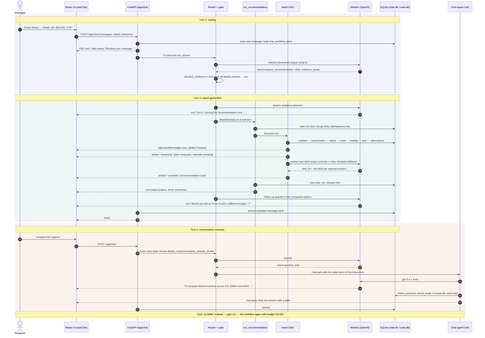
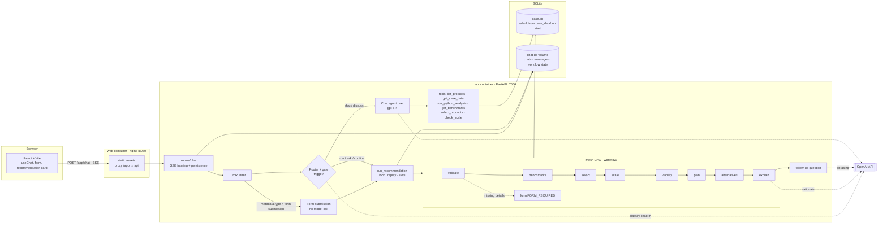

# Media Strategy Planner

A chatbot-style recommendation assistant for media strategists (an AI Engineer case study). Paste a client brief, and it asks for anything missing, then recommends the best ad product or small bundle. Each recommendation comes with benchmarks, a scale check, and a rationale explaining the rejected alternatives and the tradeoffs.

It also answers ad-hoc questions about the case data (benchmarks, CPMs, inventory, custom calculations) with its own analysis tools.

## Quick start (Docker)

You need Docker and an OpenAI API key. From the repo root:

1. **Add your OpenAI API key.**
   ```bash
   cp app/.env.example app/.env
   ```
   Then open `app/.env` and set `OPENAI_API_KEY=sk-...`. Nothing else in the file needs changing.

2. **Start the app.**
   ```bash
   docker compose up --build
   ```
   Open **http://localhost:8080** once it says the web container has started (the first build takes a few minutes).

To stop it, press Ctrl+C, or run `docker compose down`.

That one command runs the whole app:
- **web:** the React UI, served by nginx on port 8080.
- **api:** FastAPI, internal port 7666. It holds two SQLite databases:
  - **Chat history** (`/data/chat.db`) is on the `chatdata` Docker volume, so it survives `docker compose down`. Run `docker compose down -v` to wipe it.
  - **Case data** (`case.db`) is rebuilt on every start from the four case-study files in `app/api/case_data/` (`product_catalog.csv`, `campaign_history.csv`, `inventory_forecaster.csv`, `client_briefs.json`), so it can't drift from them.

No separate database server is needed.

Try the sample briefs from `app/api/case_data/client_briefs.json`, for example:

> Acme Shoes is a Retail advertiser running in the US with a $30,000 budget. They care most about click-through rate and do not have a hard impression goal.

Briefs 6 and 7 are missing a detail, so the assistant shows a short form asking for it.

Every user also starts with three **example chats**, real conversations recorded in the app:
- **A full brief:** the Acme recommendation, a what-if at $40k, then a regional inventory comparison.
- **The clarification form:** a brief with details missing, filled in on the form.
- **An ad-hoc analysis:** benchmarks per vertical.

The examples live in `app/api/src/chat_api/storage/example_chats.json`. Each user gets their own copy the first time their chats are listed; delete one and it stays deleted.

## What it does

| Brief requirement | How |
|---|---|
| 1. Chat UI for a brief | React chat UI (AI SDK v6 `useChat`) |
| 2, 7, 8.1–8.2. Identify or ask for the client, vertical, KPI, geo and budget | A router classifies each turn, and code decides whether to run, ask or chat. Missing or invalid details get an inline form, pre-filled with what's known. Details carried over from earlier turns get a confirm form. |
| 3, 8.3. Benchmarks from campaign history | Per product and vertical, CTR and in-view rate as ratio of sums |
| 4, 8.4. Product selection and impression estimates | Every product, with its CPM, KPI value, rank and the impressions the budget buys |
| 5, 8.5. Scale check, with an `inventory_risk` decision | **Usable inventory = forecast × confidence** (configurable) |
| 8.6. Rank viable products by KPI | Single product first; otherwise a bundle of up to 3, filled in KPI rank order. See [Selection rules](#selection-rules). |
| 6, 8.7. Explain the selection, rejected alternatives and tradeoffs | Every product ranked above the pick is listed with its budget, goal or inventory reason. Tradeoffs are computed. |
| 8.8, 9. A structured response the UI renders | A recommendation card, in requirement-9 order: requirements, the recommended product or bundle with forecasted impressions, why it's the best fit, rejected top alternatives, tradeoffs, calculated benchmarks. It can be copied as Markdown. |

Single steps also run on their own as tools: `get_benchmarks`, `select_products` and `check_scale` (requirements 3–5).

## Architecture

One chat endpoint handles every turn. A small router model classifies the message, code decides what happens, and a deterministic DAG over the case data computes the recommendation. Models only write the words around it: the lead-in, the rationale and the follow-up question.

### The three phases

| Phase | What happens | Model calls | Code |
|---|---|---|---|
| **Turn 1: routing** | The UI posts the message to `/app/chat`, and the API saves it and opens an SSE stream. The router classifies the intent and extracts the brief details as structured output. The gate, in code, picks `run`, `ask`, `confirm`, `chat` or `status`. | router | gate |
| **Turn 1: report generated** | A one-line lead-in says what's happening. The mesh DAG runs 8 stages, and each stage row streams as it finishes. The card streams as an artifact: loading, then the computed plan, then the written rationale. The turn closes with a follow-up question built from the result. | lead-in, explain, follow-up | 7 DAG stages |
| **Turn 2+: conversation** | The router now sees the saved state: the known details, and that a recommendation was shown. A new value ("try $40k") re-runs the workflow; a question goes to the chat agent. The chat agent gets the state block and the analysis tools over the same data. | router, chat agent (`gpt-5.4`) | tools |

### Sequence: one brief, one report, one follow-up

The Acme example: a complete brief, the recommendation card, then "compare the regions".



### Components



### What the UI receives

| Stream part | Carries | Rendered as |
|---|---|---|
| `data-status` | Transient progress text ("Reading your message…") | Status line; not saved |
| `text` | Lead-in, follow-up question, chat answers | Prose, in order |
| `tool-run_recommendation` | Input slots; output `done`, `FORM_REQUIRED`, `not_run` or `failed` | Activity step with stage rows; the form when details are missing |
| `data-workflow-stage` | One row per DAG stage: status, summary, ms | Stage list inside the step |
| `data-artifact-recommendation` | Snapshots: loading → streaming → complete, with the full Recommendation | The card, in requirement-9 order; copy as Markdown |
| `tool-*` (chat path) | Analysis tool inputs and outputs | Activity steps with Input / Output |

Every part is saved with the assistant message, so reloading a chat rebuilds the same transcript, card and form state from `chat.db`.

### Frameworks and models

- **Agent framework:** [vel](https://pypi.org/project/vel-ai/) runs the chat agent. The recommendation workflow is a [mesh](https://pypi.org/project/agentmesh-py/) DAG of deterministic steps. The model only writes the rationale; it doesn't choose the product.
- **Models, per role:**
  - chat agent: `gpt-5.4`;
  - router, lead-in, rationale writer and follow-up: `gpt-5.4-mini`, at temperature 0 (structured output for the router and the rationale).
  - Override them with `APP_CHAT_MODEL` and `APP_WORKFLOW_MODEL`.
- **The rationale** fills a schema built per brief: `best_fit`, plus one required field per product ranked above the pick. So the model can't skip or invent a rejected alternative. If the call fails, the card uses templated sentences.

## Selection rules

The brief leaves these decisions open. They live in `app/api/src/chat_api/workflow/` (`policy.py` and `steps.py`) and are configurable through `APP_INVENTORY_POLICY` and `APP_SELECTION_POLICY`.

1. **Usable inventory = forecast × confidence.** `inventory_risk` is the forecast's confidence. A product can carry the brief alone only if its usable inventory covers the impressions the budget buys at its CPM, and those impressions meet the goal, if one is set.
2. **Single product first.** If any product can carry the brief alone, the pick is the highest-KPI one of those. Every product ranked above it is reported, with its reason.
3. **Otherwise, a small bundle of up to 3 products, filled in KPI rank order.** The #1 product takes what its usable inventory allows, then #2, then #3, until the budget is spent. Any product whose share would be under the **$2,000 minimum line spend** is skipped. Budget left under $2,000 stays unspent, and the card shows it.
4. **If rank-order filling misses the impression goal**, or gives fewer than 2 lines, use the best combination that meets the goal: the one that spends the budget, then the highest blended KPI, then the fewest lines.
5. **No viable plan** when none of the above works. The card says so.

**Why rank order (rule 3):**
- *Maximizing the blended rate* picked a pricey, low-volume third line.
- *Maximizing volume* (clicks or viewable impressions) traded quality for cheap impressions.
- Rank-order filling is what "rank viable products by the requested KPI" means for a bundle.

`evals/run_matrix.py` checks these rules over 420 briefs (5 verticals × 2 KPIs × 3 geos × 7 budgets × goal or none) against an independent pandas implementation, with 0 mismatches.

## Configuration (`app/.env`)

| Variable | Default | Purpose |
|---|---|---|
| `OPENAI_API_KEY` | (required) | The model provider key |
| `APP_CHAT_PROVIDER` | `openai` | `openai` or `openrouter` (then set `OPENROUTER_API_KEY`) |
| `APP_CHAT_MODEL` | `gpt-5.4` | The chat agent |
| `APP_WORKFLOW_MODEL` | `gpt-5.4-mini` | The router and the rationale writer |
| `APP_INVENTORY_POLICY` | `adjusted` | `adjusted` (forecast × confidence), `raw` or `threshold`, or JSON such as `{"headroom": 0.1}` |
| `APP_SELECTION_POLICY` | `single_first` | `single_first` or `kpi_max`, or JSON such as `{"max_lines": 3}` |
| `LINKUP_API_KEY` | (unset) | Optional: enables the `web_search` tool |
| `LANGFUSE_*` | (unset) | Optional: Langfuse tracing |
| `APP_EXAMPLE_CHATS` | `1` in Docker, off locally | Seed the example chats for each new user |
| `WEB_PORT` | `8080` | Host port for the UI |

Docker and local dev read the same file, `app/.env`.

## Local development

```bash
# API: http://localhost:7666. Reads app/.env; SQLite files in app/api/data/
cd app/api && uv sync && APP_HOST=127.0.0.1 uv run chat-api

# Web: http://localhost:5666 (proxies /app and /health to :7666)
cd app/web && npm ci && npm run dev
```

## Tests and evals

```bash
cd app/api && uv run pytest                 # offline: no API key, no network
cd app/web && npm test                      # Vitest + Testing Library (Node 20)
```

The offline suites are acceptance tests for each workflow requirement. They include an independent pandas oracle (`app/api/evals/truth.py`) that recomputes every recommendation from the raw CSVs.

The evals are in `app/api/evals/` and write their results to `evals/results/<timestamp>/`:

| Eval | Command (from `app/api`) | Live model calls? |
|---|---|---|
| Selection matrix, 420 briefs vs the oracle | `PYTHONPATH=src:. uv run python -m evals.run_matrix` | no |
| Policy sensitivity | `PYTHONPATH=. uv run python -m evals.run_policy` | no |
| Routing, A (agent calls the tool) vs B (router + gate) | `PYTHONPATH=. uv run python -m evals.run_routing --k 1` | yes |
| Clarification loop | `PYTHONPATH=. uv run python -m evals.run_clarify --k 1` | yes |
| Rationale faithfulness, with an LLM judge | `PYTHONPATH=. uv run python -m evals.run_explain --k 1` | yes |

Headline results:
- **Selection matrix:** 0 mismatches against the independent implementation.
- **Routing:** 98.4% for the default (B), across 55 conversations.
- **Clarification:** 6/6 scenarios.
- **Rationale:** 0 schema problems.


## Repository layout

```
compose.yaml             runs the app from the repo root (includes app/docker-compose.yml)
app/
  docker-compose.yml     api + web
  api/                   FastAPI + vel + mesh (Python 3.11, uv)
    case_data/           the four case-study files (CSVs + client_briefs.json); case.db is built from them
    src/chat_api/
      chat/              router, routing (trigger/), chat agent, prompts, tools
      workflow/          the recommendation DAG: steps, policy, form, explain, service
      casedata/          builds case.db from case_data/
      storage/           chat history (SQLite repositories)
    evals/               eval runners and the independent oracle (truth.py)
    tests/               offline acceptance tests
  web/                   React + Vite UI (form, recommendation card, activity rail)
experiments/             earlier experiments (prompt ablation, model comparison, routing)
```

## Known limitations

- The workflow is validated on OpenAI models only.
- Bundles are capped at 3 products. Very large budgets (about $60k and up) can leave budget unspent when the top three products' usable inventory is exhausted; the card shows how much.
- The goal-constrained fallback brute-forces up to 3-product combinations. That's fine for 6 products; a larger catalog would want a top-K prune or a small integer program.
